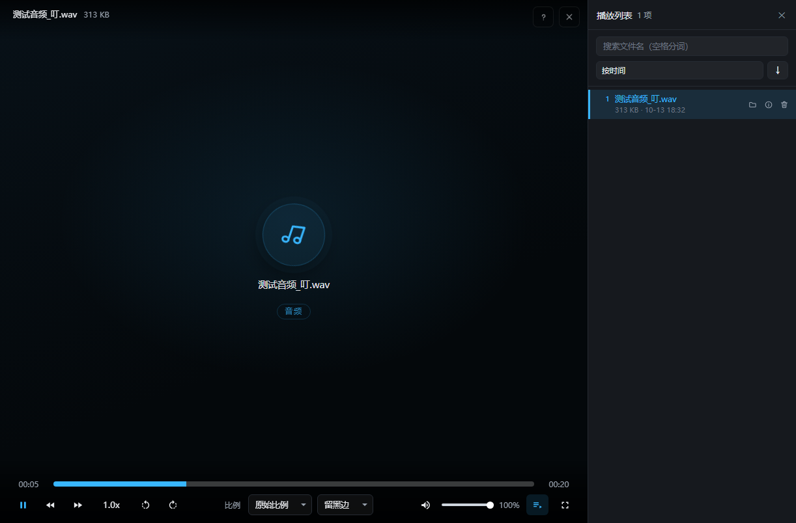
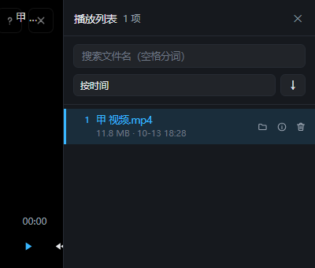
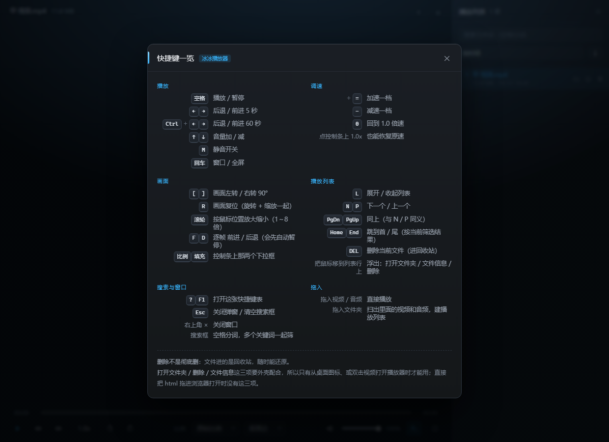

# 冰冰播放器

**一个 HTML 文件就是全部播放逻辑**，外加一个 8 MB 的小外壳，让 Windows 的「打开方式」认得它。



双击视频就能用、不需要装运行库、关掉之后本机不留任何痕迹 —— 这是它跟一般播放器最不一样的三点。

---

## 它是什么

| | |
|---|---|
| **播放逻辑** | `冰冰播放器.html` —— 单文件、零依赖、零框架，一个字的构建步骤都没有 |
| **外壳** | `冰冰播放器.exe` —— 8 MB，只干一件事：把「双击视频」接到上面那个 HTML 上 |
| **扫描脚本** | `_扫描.ps1` —— 扫出目录里的音视频，生成播放列表清单 |
| **需要的环境** | 系统已装的 Chrome 或 Edge（Windows 10/11 基本都有）；**不需要 Python、不需要 Node** |

外壳做的事很少：拿到文件路径 → 调 `_扫描.ps1` 生成清单 → 用系统浏览器以**应用模式 + 无痕**打开 HTML。

没有现成的 Chrome / Edge 也能用：直接双击那个 HTML，把文件拖进去就行。

---

## 功能

### 播放

- 拖入**文件**直接播；拖入**文件夹**自动扫出里面的音视频，建播放列表
- 支持的多选、拖动排序、点行播放
- 倍速（0.25× ～ 4×）、音量、静音、全屏
- 进度条拖动、前后 5 秒 / 60 秒跳转
- **逐帧步进**：按 `F` / `D` 一帧一帧看（会先自动暂停）
- **画面旋转与缩放**：`[` `]` 转 90°，滚轮按鼠标位置缩放 1～8 倍，`R` 一键复位
- 画面比例可切：保持比例 / 拉伸填充

### 播放列表

- 搜索框，**空格分词**，多个关键词一起筛
- 每行悬停浮出三个小图标：**打开所在文件夹** / **文件信息** / **删除**
- 按 `DEL` 删除当前文件 —— **会先进回收站**，所以随时能捞回来
- 拖进来的文件（浏览器拿不到真实路径的那种）不给这三个图标，因为点了也做不到



### 文件信息

清单里记的（文件名、大小、时间）是一份**快照**；如果文件后来被改过，弹窗会再向磁盘要一次**真实数据**，两段分开显示，不会混。


### 音频也能放

mp3 / flac / m4a 这类纯音频没有画面，早期版本就是一大块黑。现在会给一张唱片区：
唱片图标 + 文件名 + 「音频」标签，播放时缓缓转。


### 删除确认

删除是不可逆动作里最需要刹一脚的，所以 `DEL` 会先弹确认框，点「删除」或按回车才真删。


### 快捷键一览

页面上按 `?` 或 `F1` 随时调出来。表里的键帽是按真实键盘画的，键位列右对齐方便竖着扫。



---

## 快捷键全表

| 键 | 作用 |
|---|---|
| `空格` | 播放 / 暂停 |
| `←` `→` | 后退 / 前进 5 秒 |
| `Ctrl`+`←` `→` | 后退 / 前进 60 秒 |
| `↑` `↓` | 音量加 / 减 |
| `M` | 静音开关 |
| `回车` | 窗口 / 全屏 |
| `+` 或 `=` | 加速一档 |
| `-` | 减速一档 |
| `0` | 回到 1.0 倍速 |
| `[` `]` | 画面左转 / 右转 90° |
| `R` | 画面复位（旋转 + 缩放一起归位） |
| `滚轮` | 按鼠标位置放大缩小（1～8 倍） |
| `F` / `D` | 逐帧前进 / 后退 |
| `L` | 展开 / 收起播放列表 |
| `N` `P` | 下一个 / 上一个 |
| `PgDn` `PgUp` | 同上（与 `N` / `P` 同义） |
| `Home` `End` | 跳到列表首 / 尾（按当前搜索结果算） |
| `DEL` | 删除当前文件（进回收站，会先确认） |
| `?` `F1` | 打开快捷键表 |
| `Esc` | 关闭弹窗 / 清空搜索框 |

---

## 三种用法

### 一、只想看个视频（零配置）

把 `冰冰播放器.html` 拖进浏览器，或者直接双击它，再把视频 / 文件夹拖进窗口。就这样。

### 二、接到 Windows 的「打开方式」上（推荐）

把整个项目放在一个固定位置（例如 `D:\冰冰播放器`），然后：

1. **平时启动** → 双击 `启动冰冰播放器.bat`。它用 `%~dp0` 取路径，跟着项目走，不用改任何东西。
2. **想让右键菜单里出现它** —— 二选一：
   - 装了 Node.js：在 `壳源码` 目录里跑一次 `node 做注册表.js`，它会**按当前项目位置**重新生成两个 `.reg`
   - 没装 Node：右键记事本打开 `注册-加入打开方式.reg`，把里面 4 处 `D:\你的路径\冰冰播放器` 改成你的实际路径，**保存时编码保持「UTF-16 LE」**，然后双击它
3. **想让它当默认播放器** → 双击 `设为默认打开方式.bat`，在自动打开的「默认应用」设置页里搜「冰冰播放器」，点一次**设置默认值**就全设好了
4. **改回原样** → 双击 `恢复原默认打开方式.bat`

> 顺带说一句实话：**脚本改不动 Windows 的默认关联**。真正生效的钥匙存在
> `UserChoiceLatest` 里，它的哈希算法没有公开，写进去会被系统当非法值清掉。
> 所以第 3 步必须走系统设置页 —— 本项目能提供的最大便利，就是让你在设置页里
> **搜得到、点一次就能全部设好**，而不是逐个格式去点。

### 三、只想要那个 HTML

`冰冰播放器.html` 是完全独立的。拷走它一个文件就能用，跟其余部分没有任何耦合。

---

## 目录里都有什么

| 文件 | 说明 |
|---|---|
| `冰冰播放器.html` | **播放器本体**，单文件，全部 UI 和逻辑都在这儿 |
| `冰冰播放器.exe` | 外壳，用来接通「打开方式」 |
| `_扫描.ps1` | 扫描目录、生成播放列表清单 |
| `启动冰冰播放器.bat` | 项目内启动器（便携，推荐） |
| `冰冰播放器.bat` | 桌面启动器（**路径写死，用之前要改**） |
| `设为默认打开方式.bat` | 登记成默认应用，并打开系统设置页 |
| `恢复原默认打开方式.bat` | 按备份还原 |
| `查看当前默认打开方式.bat` | 列出各格式此刻实际用谁打开 |
| `注册-加入打开方式.reg` | 让右键「打开方式」里多一个「冰冰播放器」（**路径要改**） |
| `卸载-移出打开方式.reg` | 撤销上面那条 |
| `壳源码/` | 外壳的源码。想自己重新打包 exe 才用得到 |

`壳源码/` 里面：

| 文件 | 说明 |
|---|---|
| `壳.py` | 外壳主程序 |
| `小桥.py` | 本地小桥（见下文），处理「打开文件夹 / 删除 / 文件信息」 |
| `关联.py` | 默认关联的登记、查询与还原 |
| `做注册表.js` | 生成上面那两个 `.reg` |
| `做启动器.py` | 生成那几个 `.bat` |
| `冰冰播放器.spec` | PyInstaller 打包配置 |
| `图标.ico` | 程序图标 |

---

## 几个设计上的说明

### 为什么用「应用模式 + 无痕」

浏览器用 `--app=` 打开时，页面没有地址栏、没有标签页，看起来就是个原生窗口。
再加 `--incognito`，本机不留访问记录 —— **这对一个「看完就关」的播放器来说，
比复用浏览器进程省下的那点内存重要得多**。

代价是无痕窗口不能复用已经在跑的 Chrome 进程，会另起一个实例、内存略增。这是刻意的取舍。

### 「不留痕」做到了什么程度

- 页面**不写** `localStorage`：面板展开状态、音量、上次播到哪，全都不记
- 播放列表清单带时间戳，**超过 90 秒就作废**，连直接双击 HTML 都不会冒出上次的列表
  （同一次会话内刷新页面不算过期，靠 `sessionStorage` 记住「这个清单我已经认过了」）
- 关掉窗口之后，本机什么都不剩

### 本地小桥：为什么删文件要绕这么一圈

`file://` 页面**既不能删磁盘文件、也不能调起资源管理器** —— 这是浏览器的硬限制，绕不过去。
所以外壳在播放期间会起一个只监听 `127.0.0.1` 的小服务来代劳：

- 端口由系统随机分配，口令每次启动随机生成，通过启动地址的 `#bbp=端口-口令` 片段交给页面
  （URL 片段不会发给服务器，应用模式下地址栏里也看不见）
- **每个接口都要口令**，包括 `/ping` —— 否则那个口子能当端口扫描探针用
- 路径必须同时满足三条：**存在**、扩展名在音视频白名单里、**绝对路径在本次扫描的目录之下**
  —— 它不是通用删除接口
- 删除走 `SHFileOperationW` + `FOF_ALLOWUNDO`，也就是**回收站**，不是永久删除

窗口一关，页面停止心跳，外壳 **45 秒**内自己收摊退出、释放端口。不会留一个不死进程。

### 逐帧的帧长是实测出来的

浏览器没有「这个视频多少 fps」的接口。播放时用 `requestVideoFrameCallback`
把 `Δ媒体时间 ÷ Δ帧数` 算出来，采满 12 个样本就停；一次都没播过才退回 1/30。
所以 `F` / `D` 步进的粒度对得准。

---

## 已知限制

- **依赖 Chromium 内核**：mp4 / webm / mov 这类没问题，但 **mkv、avi、wmv、rmvb 播不了** ——
  不是程序的问题，是内核不解码这些容器。列表里它们会**置灰并标出「不支持」**，
  而不是藏起来让你不知道发生了什么
- **改默认关联必须走系统设置页**，脚本改不动（原因见上文）
- **播放期间外壳常驻**，大约 15 MB；窗口一关就退
- 页面和 `_扫描.ps1` **必须放在同一个目录**（清单生成后由 HTML 去读）

---

## 自己打包 exe

改了 `壳源码/` 里的东西之后：

```bat
pip install pyinstaller
cd 壳源码
python -m PyInstaller --noconfirm --distpath .. --workpath ..\_build 冰冰播放器.spec
```

`冰冰播放器.spec` 里已经把 `hiddenimports=['关联', '小桥']` 写好了 ——
这两个模块是在函数内部延迟 import 的，不显式声明有被打包器漏掉的风险。

打包出来是 `--onefile --noconsole` 的单文件：双击不弹控制台。
也正因为看不到控制台，所有关键步骤都写进同目录的 `冰冰播放器壳.log` ——
出问题先看那个日志。

> 注意：源码里 `壳.py` 的 `写死目录` 是个**兜底项**，只在「exe 所在目录找不到
> `冰冰播放器.html`」时才会用到。正常情况下外壳就在自己旁边找，所以 exe 和
> `冰冰播放器.html` 放同一个目录即可，不用改那个变量。

---

## 协议

[MIT](LICENSE)
