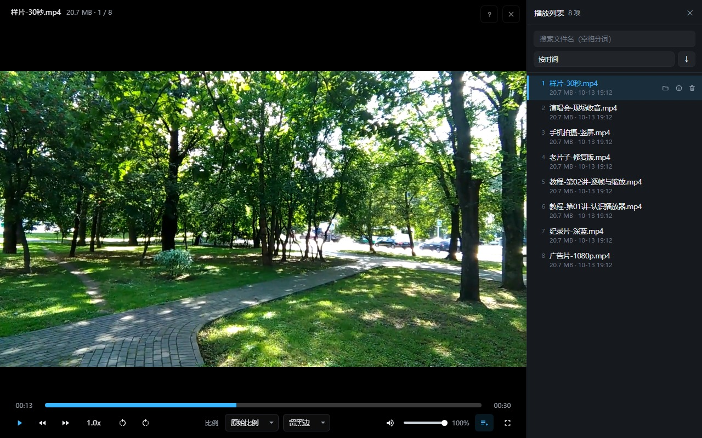
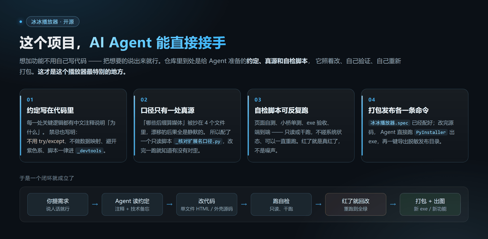
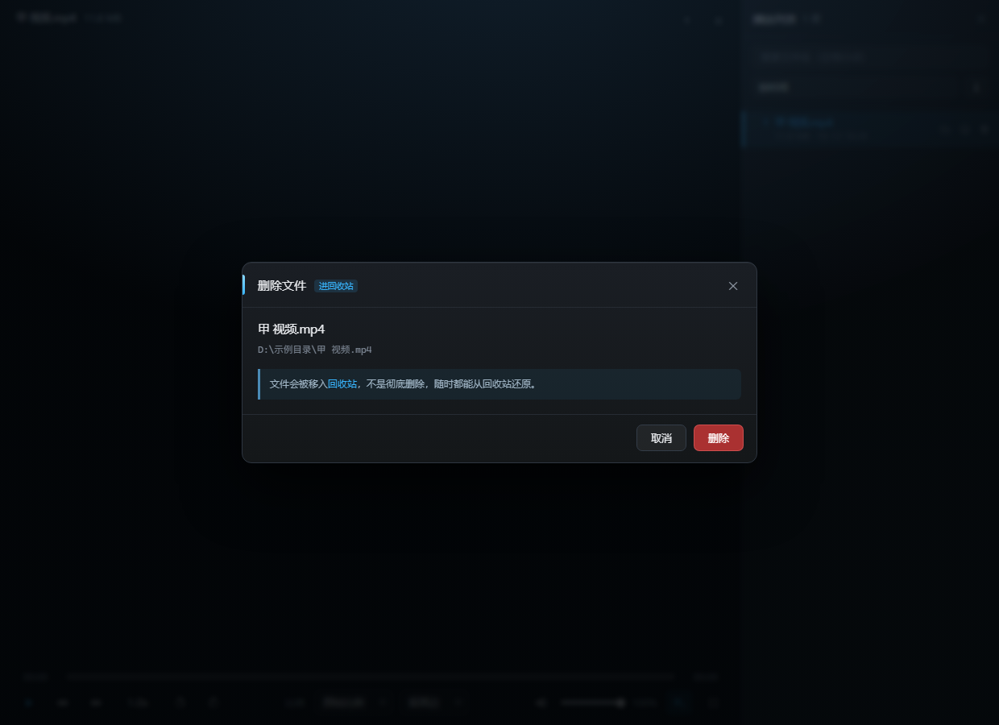
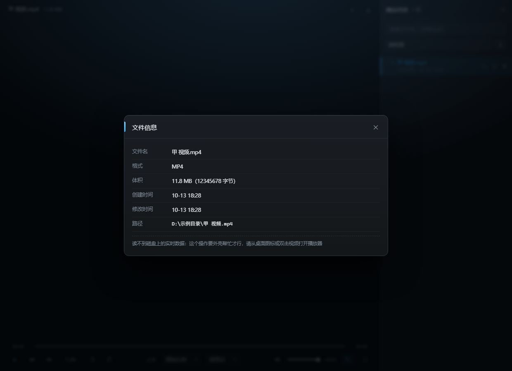
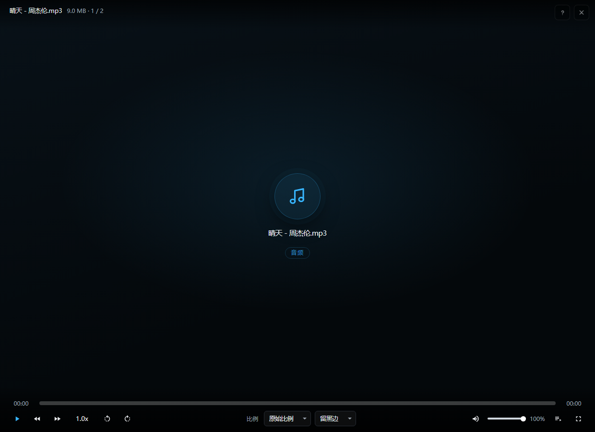

# 冰冰播放器

> **双击视频直接看，关掉之后本机什么都不留。**
> 整个播放器就是一个 HTML 文件 —— 而且**新功能可以交给 AI Agent 自己加**。

MIT 协议 · Windows 10 / 11 · 不需要 Python，也不需要 Node



### [→ 下载最新版（Windows，解压即用）](https://github.com/banshoudigua/bingbing-video-player/releases/latest)

---

## 它最特别的地方：AI Agent 能直接接手



这个仓库不只是一堆能跑的代码，还是一份**写给 AI 编程助手看的说明书**。
你把想要的功能用大白话说出来，Agent 就能照着改、自己验证、自己重新打包 ——
**你不需要看懂任何一行代码。**

它敢这么干，是因为仓库里把该说的都写清楚了：

| | |
|---|---|
| **约定写在代码里** | 关键逻辑旁边都有中文注释讲「为什么」，连禁忌都写明：不用 `try/except`、不做数据映射、配色避开紫系、开发脚本一律进 `_devtools` |
| **口径只有一处真源** | 「哪些后缀算媒体」被抄在 4 个文件里，漂移的后果全是**静默的** —— 所以配了一个只读脚本 `_核对扩展名口径.py` 盯着它们 |
| **自检脚本可反复跑** | 页面自测、小桥单测、exe 验收、端到端，全部**只读或干跑**，不碰系统状态、可以一直重跑。红了就是真红了，不是噪声 |
| **打包发布各一条命令** | `冰冰播放器.spec` 已经配好；改完源码直接跑 PyInstaller 出 exe，另有一键导出脱敏发布目录的脚本 |

举个真实的例子：有一天要「加一个按 L 键收起播放列表」。
Agent 读完成约定 → 改 HTML → 发现播放中鼠标静止时按 L 没反应（真 bug）
→ 写拆修复对照实验验证 → 修掉 → 重新跑全部自检 → 记进文档。
从头到尾没有一句「我猜」。

> 换句话说：**这个播放器是可以长大的。** 你想到什么功能，说出来就有了。

---

## 30 秒上手

1. 到 [Releases](https://github.com/banshoudigua/bingbing-video-player/releases/latest) 下载 `bingbing-player-v1.0.zip`，解压到任意文件夹
2. 双击里面的 **`启动冰冰播放器.bat`**
3. 窗口出来后，把**视频文件**或**整个文件夹**拖进去

拖文件夹会自动扫出里面的音视频、排成播放列表。

> 想让它变成「双击视频就用它打开」？看 [使用说明](使用说明.md)。
> 没装 Chrome / Edge 也能用：直接把 `冰冰播放器.html` 拖进浏览器，功能一模一样。

---

## 功能

### 播放

- 拖文件直接播；拖文件夹自动扫描并建列表
- 倍速 0.25× – 4×、音量、静音、全屏、画面比例切换
- **逐帧步进**：按 `F` / `D` 一帧一帧看（会先自动暂停）
- **画面旋转与缩放**：`[` `]` 转 90°，滚轮按鼠标位置缩放 1–8 倍，`R` 一键复位
- 播放中鼠标静止 2.5 秒，所有浮层自动淡出 —— 只剩下画面


### 播放列表

- 搜索框支持**空格分词**，多个关键词一起筛
- 每行悬停浮出三个小图标：**打开所在文件夹** / **文件信息** / **删除**


### 删除进的是回收站

按 `DEL` 删当前文件，**先弹确认框**；删掉的进回收站，随时能捞回来。



### 文件信息分两段

清单里记的是扫描那一刻的**快照**；如果文件后来被改过，弹窗会再向磁盘要一次**真实数据**，两段分开显示，不会混。



### 音频也能放

mp3 / flac / m4a 这类没有画面的文件，早期版本只能给一大块黑。现在给的是一张唱片区：



### 快捷键随时查

按 `?` 或 `F1` 调出来，表里的键帽是按真实键盘画的。


---

## 快捷键全表

| 键 | 作用 |
|---|---|
| `空格` | 播放 / 暂停 |
| `←` `→` | 后退 / 前进 5 秒 |
| `Ctrl` + `←` `→` | 后退 / 前进 60 秒 |
| `↑` `↓` | 音量加 / 减 |
| `M` | 静音开关 |
| `回车` | 窗口 / 全屏 |
| `+` 或 `=` / `-` / `0` | 加速一档 / 减速一档 / 回到 1.0 倍速 |
| `[` `]` | 画面左转 / 右转 90° |
| `R` | 画面复位（旋转 + 缩放一起归位） |
| `滚轮` | 按鼠标位置放大缩小（1 – 8 倍） |
| `F` `D` | 逐帧前进 / 后退 |
| `L` | 展开 / 收起播放列表 |
| `N` `P` | 下一个 / 上一个 |
| `PgDn` `PgUp` | 同上（与 `N` / `P` 同义） |
| `Home` `End` | 跳到列表首 / 尾（按当前搜索结果算） |
| `DEL` | 删除当前文件（进回收站，会先确认） |
| `?` `F1` | 打开这张快捷键表 |
| `Esc` | 关闭弹窗 / 清空搜索框 |

---

## 让它变成你双击视频时的默认播放器

`启动冰冰播放器.bat` 是便携的，放哪都能跑。要让右键菜单和双击都认得它，还差两步：

1. **让右键「打开方式」里出现它** —— 二选一：
   - 装了 Node.js：在 `壳源码` 目录里跑一次 `node 做注册表.js`，它按当前项目位置重新生成两个 `.reg`
   - 没装 Node：用记事本打开 `注册-加入打开方式.reg`，把里面 **4 处** `D:\你的路径\冰冰播放器`
     改成你的实际路径，**保存时编码选「UTF-16 LE」**，然后双击它
2. **设成默认** —— 双击 `设为默认打开方式.bat`，在打开的「默认应用」设置页里搜「冰冰播放器」，
   点一次**设置默认值**就全设好了。想改回去就双击 `恢复原默认打开方式.bat`

> 说句实话：**脚本改不动 Windows 的默认关联。** 真正说了算的钥匙存在 `UserChoiceLatest` 里，
> 它的哈希算法没有公开，硬写进去会被系统当成非法值清掉。
> 所以第 2 步必须走系统设置页 —— 这个项目能提供的最大便利，就是让你**搜得到、点一次就全设好**，
> 而不是 17 种格式挨个去点。

---

## 常见问题

**mkv / avi / wmv / rmvb 为什么播不了？**
不是程序的问题，是 Chromium 内核不解码这些容器。列表里它们会**置灰并标出「不支持」**，
而不是藏起来让你不知道发生了什么。能正常播的是 mp4 / m4v / webm / mov / ogv，
加上 mp3 / m4a / aac / wav / flac / ogg / opus 这些音频。

**要装什么运行库吗？**
不用。系统里有 Chrome 或 Edge 就行，Windows 10 / 11 基本都有。

**会留痕迹吗？**
不会。页面不写 `localStorage`，播放列表清单超过 90 秒就作废，
浏览器用**应用模式 + 无痕**启动 —— 关掉窗口，本机什么都不剩。

**点「删除」是真删吗？**
进回收站，不是永久删除，随时能捞回来。

**能装在 Mac / Linux 上用吗？**
目前不行，外壳是 Windows 专用的。

---

## 设计上的几个取舍

### 为什么用「应用模式 + 无痕」

浏览器用 `--app=` 打开时，页面没有地址栏、没有标签页，看起来就是个原生窗口；
再加 `--incognito`，本机不留访问记录。代价是无痕窗口不能复用已经在跑的 Chrome 进程，
会另起一个实例、内存略增 —— **对一个「看完就关」的播放器来说，这笔账划算**。

### 「不留痕」做到了什么程度

- 页面**不写** `localStorage`：面板展开状态、音量、上次播到哪，全都不记
- 播放列表清单带时间戳，**超过 90 秒就作废**，连直接双击 HTML 都不会冒出上次的列表
  （同一次会话里刷新页面不算过期，靠 `sessionStorage` 记住「这份清单我已经认过了」）
- 关掉窗口之后，本机什么都不剩

### 删文件为什么要绕一圈

`file://` 页面**既不能删磁盘文件、也不能调起资源管理器**，这是浏览器的硬限制。
所以外壳在播放期间会起一个只监听 `127.0.0.1` 的小服务来代劳：

- 端口由系统随机分配，口令每次启动随机生成，通过启动地址的 `#bbp=端口-口令` 片段交给页面
- **每个接口都要口令**，包括 `/ping` —— 否则那个口子能当端口扫描探针用
- 路径必须同时满足三条：**存在**、扩展名在音视频白名单里、**绝对路径在本次扫描的目录之下**
- 删除走「回收站」而不是永久删除

窗口一关，页面停止心跳，外壳 **45 秒**内自己收摊退出、释放端口，不会留一个不死进程。

### 逐帧的帧长是实测出来的

浏览器没有「这个视频多少 fps」的接口。播放时用 `requestVideoFrameCallback`
把「Δ媒体时间 ÷ Δ帧数」算出来，采满 12 个样本就停；一次都没播过才退回 1/30。

---

## 目录里都有什么

| 文件 | 说明 |
|---|---|
| `冰冰播放器.html` | **播放器本体**，单文件，全部 UI 和逻辑都在这儿 |
| `冰冰播放器.exe` | 外壳，用来接通 Windows 的「打开方式」 |
| `_扫描.ps1` | 扫描目录、生成播放列表清单 |
| `启动冰冰播放器.bat` | 项目内启动器（便携，推荐） |
| `冰冰播放器.bat` | 桌面启动器（**路径写死，用之前要改**） |
| `设为默认打开方式.bat` | 登记成默认应用，并打开系统设置页 |
| `恢复原默认打开方式.bat` | 按备份还原 |
| `查看当前默认打开方式.bat` | 列出各格式此刻实际用谁打开 |
| `注册-加入打开方式.reg` | 让右键「打开方式」里多一个「冰冰播放器」（**路径要改**） |
| `卸载-移出打开方式.reg` | 撤销上面那条 |
| `壳源码/` | 外壳的源码。想自己重新打包 exe 才用得到 |

`壳源码/` 里面：

| 文件 | 说明 |
|---|---|
| `壳.py` | 外壳主程序 |
| `小桥.py` | 本地小桥，处理「打开文件夹 / 删除 / 文件信息」 |
| `关联.py` | 默认关联的登记、查询与还原 |
| `做注册表.js` | 生成上面那两个 `.reg` |
| `做启动器.py` | 生成那几个 `.bat` |
| `冰冰播放器.spec` | PyInstaller 打包配置 |
| `图标.ico` | 程序图标 |

---

## 自己打包 exe

改了 `壳源码/` 里的东西之后：

```bat
pip install pyinstaller
cd 壳源码
python -m PyInstaller --noconfirm --distpath .. --workpath ..\_build 冰冰播放器.spec
```

`冰冰播放器.spec` 里已经把 `hiddenimports=['关联', '小桥']` 写好了 ——
这两个模块是在函数内部延迟 import 的，不显式声明有被打包器漏掉的风险。

打包出来是 `--onefile --noconsole` 的单文件：双击不弹控制台。
也正因为看不到控制台，所有关键步骤都写进同目录的 `冰冰播放器壳.log` ——
出问题先看那个日志。

---

## 协议

[MIT](LICENSE)
